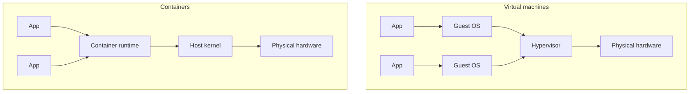

# Containers vs Virtual Machines

## TL;DR

- A **dedicated server** runs one workload on one operating system. Simple, but slow to provision and expensive to underuse.
- A **virtual machine** virtualizes hardware. Each VM carries a full guest OS, so isolation is strong but the overhead is large.
- A **container** isolates ordinary processes on the host kernel. It starts in milliseconds and shares the kernel with the host.
- Containers are a packaging and isolation tool, not a replacement for the VM security boundary.
- Use containers for application packaging and density; use VMs when you need hard multi-tenant isolation or a different kernel.

## Why it matters

Before containers, the smallest deployable unit was usually a VM. That meant every app paid for an OS: boot time, memory, patching and disk. Containers remove the guest OS from the equation. Understanding the difference explains why Docker images are small, why containers are fast, and where their limits are.

## Core concepts

### Three ways to run a workload

| Model | What is virtualized | Isolation | Startup | Typical size | Best for |
| --- | --- | --- | --- | --- | --- |
| Dedicated host | Nothing | Full machine | Minutes | Whole machine | Legacy, licensing, max performance |
| Virtual machine | Hardware (CPU, RAM, disk, network) | Strong: separate kernel | Tens of seconds to minutes | GBs | Multi-tenant, different kernels, compliance |
| Container | Processes (namespaces, cgroups) | Process-level: shared kernel | Milliseconds to seconds | MBs | App packaging, microservices, CI |

### How a container actually works

A container is not a small VM. It is one or more Linux processes with three kernel features applied:

- **Namespaces** give the process its own view of PID, network, mount, UTS, IPC and user IDs.
- **cgroups** limit and account for CPU, memory and I/O.
- **A layered filesystem** (overlayfs and friends) provides the container's root filesystem from image layers.

The kernel is the host's kernel. That is the source of both the speed and the main security caveat.



### What Docker adds on top

The kernel features existed before Docker. Docker made them usable:

- a standard **image format** (OCI),
- a **registry** for distribution,
- a **build** system (Dockerfile),
- a **CLI and API**,
- **networking and volumes** conventions.

## Commands and examples

```bash
# Check the client, server and runtime details
docker version
docker info

# Run a throwaway container
docker run --rm hello-world

# Prove the container shares the host kernel
docker run --rm alpine uname -a
# The kernel release matches the host, not a guest OS.

# Look at PID 1 inside a container
docker run --rm alpine sh -c 'cat /proc/1/cmdline; echo'
```

On Docker Desktop for macOS or Windows, the "host" is a Linux VM managed by Docker Desktop, so the kernel you see belongs to that VM.

## Gotchas

- **The kernel is shared.** A kernel vulnerability can cross the container boundary. Run untrusted workloads in VMs or with stronger sandboxing.
- **Root in a container is close to root on the host** unless you use user namespaces, rootless mode or a hardened runtime. Do not treat a container as a security boundary by default.
- **Containers are ephemeral.** The writable layer disappears with the container; use volumes for data.
- **Windows and Linux containers differ.** A Windows container needs a Windows kernel; Linux containers on Windows run inside a VM.
- **Architecture matters.** An `amd64` image will not run natively on an `arm64` host.

## Cheat sheet

| Question | Answer |
| --- | --- |
| What is a container? | An isolated process (or group of processes) on the host kernel |
| What is an image? | A read-only, layered filesystem plus metadata used to create containers |
| Does a container have its own kernel? | No, it shares the host kernel |
| Does a VM have its own kernel? | Yes, each VM runs a guest OS |
| Fastest to start? | Container |
| Strongest isolation? | VM (or a sandboxed container runtime) |
| Where does container data go? | Volumes or bind mounts, not the writable layer |

## Practice

1. Run `docker run --rm alpine uname -a` and compare the kernel with `uname -a` on the host.
2. Run `docker run --rm -it ubuntu:24.04 sh`, then inspect `/proc/1/cmdline` and `mount`.
3. Start a container with `-d`, exec into it, then stop and remove it. Note which steps are required.

## Further reading

- [Docker overview](https://docs.docker.com/get-started/docker-overview/)
- [Docker Engine security](https://docs.docker.com/engine/security/)
- [Linux namespaces](https://man7.org/linux/man-pages/man7/namespaces.7.html)
- [Linux cgroups](https://man7.org/linux/man-pages/man7/cgroups.7.html)
- [Open Container Initiative](https://opencontainers.org/)

## Source

- Raw capture (local only): `raw/DevOps-Tool/Docker/docker.md`, `raw/DevOps-Tool/Docker/docker.txt`
- Video referenced in the raw notes: <https://www.youtube.com/watch?v=rjjES5IsPdg>
