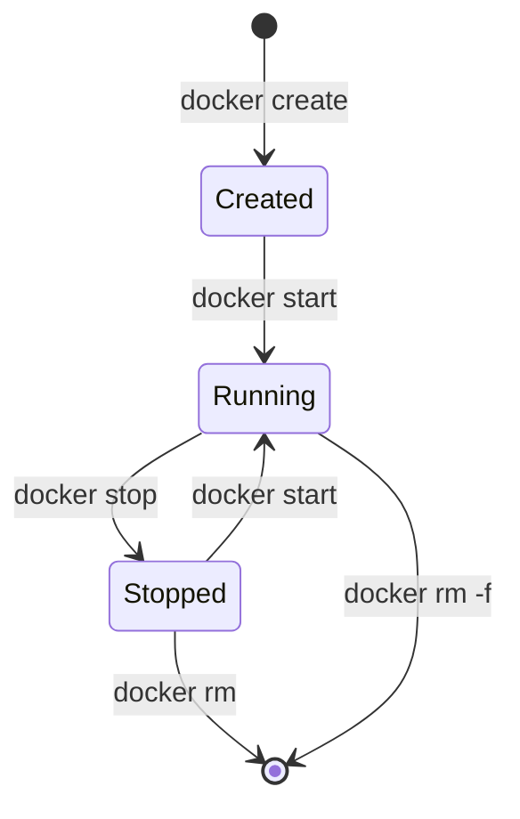

# Docker CLI and the Container Lifecycle

## TL;DR

- An **image** is a read-only template; a **container** is a running (or stopped) instance of it.
- `docker run` is shorthand for pull (if missing), create and start.
- A stopped container still exists and still occupies disk until you remove it.
- Use `docker ps -a` to see everything, `docker logs` to debug, and `docker rm` to clean up.
- Prefer `--rm` for throwaway containers and named volumes for anything you need to keep.

## Why it matters

Most Docker confusion comes from mixing up images, containers and lifecycle states. Once you can see the pull -> create -> start -> stop -> remove path clearly, the CLI stops feeling like a pile of flags.

## Core concepts

### Images vs containers

| Thing | What it is | Mutable? | Created by |
| --- | --- | --- | --- |
| Image | Layered read-only filesystem + metadata | No | `docker build`, `docker pull` |
| Container | A process with an isolated view, plus a thin writable layer | Yes (writable layer) | `docker create`, `docker run` |

### Lifecycle



`docker run` performs pull (if the image is absent), create and start in one step.

### `docker run` flags worth memorizing

| Flag | Meaning |
| --- | --- |
| `-d`, `--detach` | Run in the background |
| `-it` | Interactive terminal (`-i` stdin + `-t` tty) |
| `--rm` | Delete the container when it exits |
| `--name` | Give the container a stable name |
| `-p host:container` | Publish a container port on the host |
| `-e KEY=value` | Set an environment variable |
| `-v source:target[:ro]` | Mount a volume or bind mount |
| `--network` | Attach to a Docker network |

## Commands and examples

```bash
# Client and daemon information
docker version
docker -v
docker info

# Images
docker pull nginx:1.27-alpine
docker images
docker images -q

# Containers: running only, then all
docker ps
docker ps -a

# Filter by name (see the raw screenshot below)
docker ps -a --filter name=web

# Create without starting, then start
docker create --name web nginx:1.27-alpine
docker start web

# Run a shell inside a running container
# The shell must exist in the image; alpine has sh, not bash
docker exec -it web sh

# Graceful stop: SIGTERM, then SIGKILL after the timeout
docker stop -t 10 web

# Logs (also works on a stopped container)
docker logs web
docker logs -f web

# Low-level details as JSON
docker inspect web

# Remove a stopped container; -f kills a running one
docker rm web
docker rm -f web

# Remove an image; -f forces removal even when stopped containers reference it
docker rmi nginx:1.27-alpine
docker rmi -f nginx:1.27-alpine

# Remove unused images
docker image prune

# One-shot run
docker run -d --name web -p 8080:80 nginx:1.27-alpine
docker run --rm -it ubuntu:24.04 bash
```

### Linux process commands in the raw notes

These are host/Linux process tools, useful when you are inside a container or debugging:

```bash
ps a    # processes associated with a terminal, for all users
ps -A   # all processes
ps x    # include processes without a controlling terminal (background)
ps u    # user-oriented format: owner, CPU, memory
```

Inside a container, `ps` only shows processes in that container's PID namespace. PID 1 is the container's entrypoint, not the host init.

### Screenshots from the raw notes

The two CLI screenshots are kept in the local raw capture and are not published:

- `raw/DevOps-Tool/Docker/name-filter.png` - filtering containers by name.
- `raw/DevOps-Tool/Docker/start-stop.png` - starting and stopping containers.

## Gotchas

- **A stopped container is not deleted.** Use `docker ps -a` and `docker rm` to clean up.
- **`docker run` is not just "start".** It creates a new container every time. Use `docker start` for an existing one.
- **Ports are `host:container`.** `-p 8080:80` means host 8080 -> container 80.
- **`docker rm` needs a stopped container** unless you pass `-f`.
- **`docker rmi -f` does not remove containers.** It forces image removal and can leave containers referencing a missing image; check first.
- **`docker system prune -a` removes stopped containers, unused networks, dangling images and build cache.** Do not run it casually.
- **`docker logs` shows stdout/stderr only**, not files written inside the container.
- **`docker exec` needs a running container** and a command that exists in the image.
- **`-t` on `docker stop` is a timeout**, not "force". The engine sends SIGTERM, waits, then SIGKILL.

## Cheat sheet

| Goal | Command |
| --- | --- |
| List images | `docker images` |
| List running containers | `docker ps` |
| List all containers | `docker ps -a` |
| Pull an image | `docker pull IMAGE:TAG` |
| Create + start | `docker run [flags] IMAGE` |
| Start existing | `docker start NAME` |
| Stop | `docker stop NAME` |
| Shell into container | `docker exec -it NAME sh` |
| Logs | `docker logs -f NAME` |
| Inspect | `docker inspect NAME` |
| Remove container | `docker rm NAME` |
| Remove image | `docker rmi IMAGE` |
| Clean unused images | `docker image prune` |

## Practice

1. Run nginx detached on port 8080, curl it, then stop and remove it.
2. Create a container without starting it, inspect its state, start it, exec into it, then remove it.
3. Run an Ubuntu container with `--rm`, exit the shell, and confirm no container remains.

## Further reading

- [Docker CLI reference](https://docs.docker.com/reference/cli/docker/)
- [`docker run` reference](https://docs.docker.com/reference/cli/docker/container/run/)
- [`docker ps` reference](https://docs.docker.com/reference/cli/docker/container/ls/)
- [`docker logs` reference](https://docs.docker.com/reference/cli/docker/container/logs/)

## Source

- Raw capture (local only): `raw/DevOps-Tool/Docker/docker.md`, `raw/DevOps-Tool/Docker/docker.txt`
- Video referenced in the raw notes: <https://www.youtube.com/watch?v=rjjES5IsPdg>
