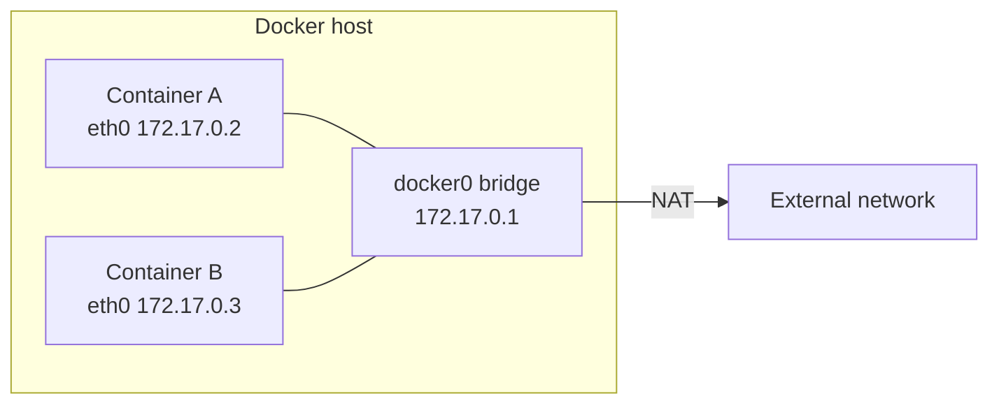

# Docker Networking

## TL;DR

- Docker networks are software constructs built on Linux bridges, veth pairs and iptables.
- The default `docker0` bridge uses `172.17.0.0/16`; the bridge itself is usually `172.17.0.1`.
- Containers on the **default** bridge do not get automatic name-based DNS.
- Containers on a **user-defined** bridge do, and are isolated from unrelated networks.
- Publish ports with `-p host:container`; without it, the container is only reachable on its Docker network.

## Why it matters

"Two containers cannot talk to each other" and "the container is not reachable from my laptop" are the two most common Docker networking failures. Both come down to which network the container is on and whether a port was published.

## Core concepts

### The Linux pieces

A **bridge** is a layer-2 device that forwards traffic between segments. Docker creates software bridges on the host.

- `docker0` is created by default when the daemon starts.
- Each container gets a `veth` pair: one end is `eth0` inside the container, the other is attached to the bridge on the host.
- The host routes and NATs traffic, with rules in iptables.
- Port publishing adds a NAT rule from a host port to a container port.



### Network drivers

| Driver | What it does | Typical use |
| --- | --- | --- |
| `bridge` | Software bridge on one host | Default local development |
| `host` | Removes network isolation; container uses the host stack | High performance, Linux-specific |
| `none` | No network interface beyond loopback | Fully isolated batch jobs |
| `overlay` | Connects multiple Docker daemons | Swarm / multi-host |
| `ipvlan` | Full control over IPv4/IPv6 addressing | Advanced L2/L3 setups |
| `macvlan` | Gives the container its own MAC address | Legacy apps that need L2 presence |

A "user-defined network" is not a separate driver. It is a network you create, usually with the `bridge` driver, and it behaves differently from the default bridge.

### Default bridge vs user-defined bridge

| | Default `docker0` | User-defined bridge |
| --- | --- | --- |
| Automatic DNS by container name | No | Yes |
| Isolation from unrelated containers | Weak | Yes, per network |
| Connect/disconnect a running container | Possible, but not the default workflow | `docker network connect` / `disconnect` |
| Recommended for apps | No | Yes |

Containers can join more than one network, which is how you isolate a database from the public-facing service.

## Commands and examples

```bash
# Host interfaces and addresses
ip a

# Networks
docker network ls
docker network create app-net
docker network create --subnet 10.0.0.0/16 app-net
docker network inspect app-net

# Run containers on a user-defined network
docker run -d --name web --network app-net nginx:1.27-alpine
docker run -d --name api --network app-net nginx:1.27-alpine

# Name-based DNS works on a user-defined network
docker run --rm --network app-net alpine sh -c 'nslookup web'

# Attach or detach a running container
docker network connect app-net web
docker network disconnect app-net web

# Publish a port to the host
docker run -d --name web -p 8080:80 nginx:1.27-alpine

# Restrict the published port to localhost only
docker run -d --name web-local -p 127.0.0.1:8080:80 nginx:1.27-alpine

# Clean up
docker network rm app-net
docker network prune
```

## Gotchas

- **Container IPs are not stable.** Do not hardcode `172.x.x.x`; use the network alias or service name.
- **The default bridge has no automatic DNS.** Two containers on `docker0` must use IPs unless you link them (legacy) or move them to a user-defined network.
- **`-p` binds to `0.0.0.0` by default.** Restrict to `127.0.0.1` when the service should not be public.
- **`--network host` removes isolation.** On Linux the container shares the host network stack, and `-p` is ignored.
- **Docker Desktop behaves differently.** On macOS and Windows, containers run inside a Linux VM, so host networking does not mean your laptop's network stack.
- **Subnet collisions happen.** `172.17.0.0/16` can overlap with VPN or corporate ranges; change the daemon's address pool in that case.
- **Compose does not use `docker0`.** It creates a project-scoped user-defined bridge named `<project>_default`, which is why service names resolve. This corrects the raw note that says every Compose container joins the default bridge.
- **Overlay is not a local-development default.** It needs a Swarm or multi-host setup.

## Cheat sheet

| Task | Command |
| --- | --- |
| List networks | `docker network ls` |
| Create a network | `docker network create NAME` |
| Create with a subnet | `docker network create --subnet 10.0.0.0/16 NAME` |
| Inspect | `docker network inspect NAME` |
| Run on a network | `docker run --network NAME IMAGE` |
| Attach | `docker network connect NAME CONTAINER` |
| Detach | `docker network disconnect NAME CONTAINER` |
| Publish a port | `docker run -p 8080:80 IMAGE` |
| Publish to localhost | `docker run -p 127.0.0.1:8080:80 IMAGE` |
| Test DNS | `nslookup SERVICE` from another container |

## Practice

1. Create `app-net`, run two nginx containers on it, and resolve one from the other with `nslookup`.
2. Run the same two containers on the default bridge and confirm name resolution fails.
3. Publish nginx on `127.0.0.1:8080`, confirm it works locally, then change it to `0.0.0.0` and note the exposure difference.

## Further reading

- [Docker networking overview](https://docs.docker.com/engine/network/)
- [Bridge network driver](https://docs.docker.com/engine/network/drivers/bridge/)
- [Host network driver](https://docs.docker.com/engine/network/drivers/host/)
- [Docker and iptables](https://docs.docker.com/engine/network/packet-filtering-firewalls/)

## Source

- Raw capture (local only): `raw/DevOps-Tool/Docker/docker.md`, `raw/DevOps-Tool/Docker/docker.txt`
- Video referenced in the raw notes: <https://www.youtube.com/watch?v=rjjES5IsPdg>
